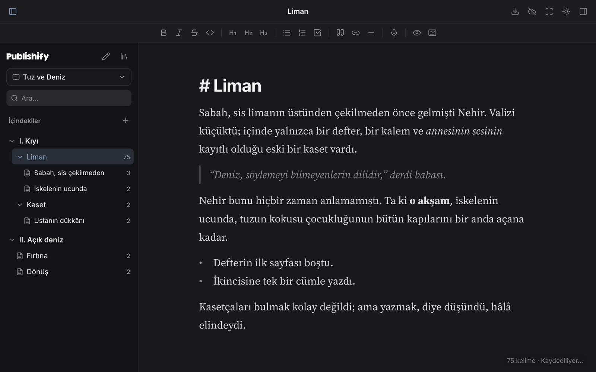

<p align="center">
  <a href="https://publishify.app/">
    <picture>
      <source media="(prefers-color-scheme: dark)" srcset=".github/assets/logo-beyaz.svg">
      
    </picture>
  </a>
</p>

<h1 align="center">Publishify</h1>

<p align="center"><strong>Write. Refine. Publish.</strong><br>A writing editor made for books, with an editorial board beside it.</p>

<p align="center">
  <a href="https://write.publishify.app/"><strong>Start writing</strong></a> ·
  <a href="https://publishify.app/">Website</a> ·
  <a href="https://publishify.app/tr/">Türkçe</a> ·
  <a href="https://github.com/publishify/plugin">Editorial board plugin</a> ·
  <a href="https://publishify.app/sample-report/">Sample report</a>
</p>

<p align="center">
  
</p>

---

**Publishify is a writing editor for books.** It runs in the browser with nothing to install, and you can start writing without an account. You plan a book as **parts › chapters › scenes**, write in a quiet editor where Markdown formats itself, and export the book as Word, EPUB, PDF or Markdown when it is ready for a publisher or a store.

When you want another pair of eyes, the **Publishify editorial board** reads your book. The board is a separate plugin that runs inside your own AI application (Claude first): an Editor, a Continuity Checker, a panel of three readers and an Editor-in-Chief give quote-backed notes and a dashboard with the Wayfarer's Seven Stages map. Your manuscript never goes to Publishify's servers for that; see [publishify/plugin](https://github.com/publishify/plugin).

This repository is the editor: its browser client and the Cloudflare Worker behind it.

## Contents

- [What you can do](#what-you-can-do)
- [Status](#status)
- [How Publishify fits together](#how-publishify-fits-together)
- [Repository layout](#repository-layout)
- [Develop](#develop)
- [Deploy](#deploy)
- [History](#history)
- [Türkçe](#türkçe)
- [Licence and contact](#licence-and-contact)

## What you can do

- **Write a book, not a document.** Parts, chapters and scenes in one tree, with word counts and a daily goal.
- **Write in peace.** Live Markdown, focus mode, themes, dictation and version history for each chapter.
- **Keep your work.** Guest writing is saved in your browser; with an account (passkey or Google), books sync through your account and keep their history.
- **Write in your language.** Left-to-right and right-to-left scripts; the interface comes in several languages.
- **Get it out.** Import DOCX, Markdown or text; export Word, EPUB, PDF or Markdown.
- **Have it read.** The editorial board plugin reads the exported book in your own AI and gives evidence-linked notes.

<table>
  <tr>
    <td width="50%"><br><sub><b>Writing mode.</b> Full screen, only you and the page.</sub></td>
    <td width="50%"><br><sub><b>Templates.</b> Start a novel, a story collection or an essay with its structure in place.</sub></td>
  </tr>
  <tr>
    <td width="50%"><br><sub><b>Every direction.</b> Right-to-left scripts such as Arabic and Ottoman Turkish.</sub></td>
    <td width="50%"><br><sub><b>An editorial board.</b> The plugin reads your book in your own AI. Illustration with sample data.</sub></td>
  </tr>
</table>

## Status

18 November 2026. The editor is live at [write.publishify.app](https://write.publishify.app/); [staging.publishify.app](https://staging.publishify.app/) runs the same code against separate test data.

| Area | State |
| --- | --- |
| Writing, book structure, local saving | Working; covered by automated tests |
| Import and export (DOCX, Markdown, TXT; Word, EPUB, PDF) | Working; browser acceptance tests pending |
| Passkey accounts, recovery and sessions | Working; device acceptance tests pending |
| Sync, version history and conflict protection | Working; multi-device tests pending |
| Google sign-in | Implemented |
| Google Drive sync | Not yet |
| Public reading pages | Built; switched off |
| Editorial review | Moved to the [board plugin](https://github.com/publishify/plugin); the editor itself reads nothing with a model |

## How Publishify fits together

| What | Where | Repository |
| --- | --- | --- |
| The writing editor (this repository) | `write.publishify.app`, `staging.publishify.app` | [publishify/publishify](https://github.com/publishify/publishify) (public) |
| The editorial board plugin | Installed in your AI application | [publishify/plugin](https://github.com/publishify/plugin) (public) |
| The board's server: sign-in, licences, role cards | `mcp.publishify.app` | `publishify/plugin-mcp` (private) |
| The website | `publishify.app` | `publishify/site` (private) |

Retired repositories, kept as archives: `publishify/platform` (where this editor was built, together with a server-side review service that was abandoned), [publishify/studio](https://github.com/publishify/studio) (the first editor), [publishify/masthead](https://github.com/publishify/masthead) (the first board plugin) and [publishify/website](https://github.com/publishify/website) (the plugin-only site).

## Repository layout

| Path | What it holds | Where it runs |
| --- | --- | --- |
| [`app/client`](app/client) | The editor: book tree, live Markdown, local saving, import and export, the panels | In the writer's browser |
| [`app/api`](app/api) | Hono API: accounts, passkeys, Google sign-in, sync, publishing | Cloudflare Worker |
| [`app/api/src/book-do.ts`](app/api/src/book-do.ts) | One Durable Object per book: text and version history | Cloudflare Durable Objects |
| [`app/api/migrations`](app/api/migrations) | D1 tables | Applied to each environment's D1 |
| [`packages/contracts`](packages/contracts) | Shared types | Build time |
| [`scripts`](scripts) | The language rule (no Turkish in code) and data-integrity tests | Developer machine and CI |
| [`.github/workflows/ci.yml`](.github/workflows/ci.yml) | Lint, types, tests, language rule and build | GitHub Actions |

Storage: the browser keeps a local copy (IndexedDB); with an account, D1 holds account records, each book lives in its Durable Object and R2 holds snapshots.

## Develop

Requires **Node.js 24 or later** and **pnpm 12.18.0**. You do not need a Google account, a payment account or any model key.

```sh
git clone https://github.com/publishify/publishify.git
cd publishify
pnpm install --frozen-lockfile
pnpm check        # lint, types, tests, language rule and client build
```

Run the editor locally with its Worker and local D1, R2 and Durable Objects:

```sh
pnpm build
pnpm exec wrangler d1 migrations apply DB --local --config app/api/wrangler.jsonc --persist-to .wrangler/local
pnpm exec wrangler dev --config app/api/wrangler.jsonc --local --port 8787 --persist-to .wrangler/local
```

Then open http://localhost:8787. For client work with hot reload, `pnpm dev`.

Conventions: TypeScript (strict). Code, identifiers, comments and commit messages are in English; author-facing text lives in `app/client/src/i18n/` and is reached by key. Never log manuscript text.

## Deploy

Three Wrangler environments share one configuration, [`app/api/wrangler.jsonc`](app/api/wrangler.jsonc): local, `staging` (`staging.publishify.app`) and `production` (`write.publishify.app`). Each has its own D1, R2 and Durable Objects. Changes go to staging first:

```sh
pnpm build
pnpm exec wrangler d1 migrations apply DB --remote --env staging --config app/api/wrangler.jsonc
pnpm exec wrangler deploy --env staging --config app/api/wrangler.jsonc
```

Production uses `--env production` after staging has been checked. Deploying needs an authorised Cloudflare account; no credentials are kept in this repository.

## History

- **9–12 November 2026:** the first editor, Studio ([publishify/studio](https://github.com/publishify/studio)), and the first board plugin, Masthead.
- **12–14 November 2026:** the editor was rebuilt in `publishify/platform` together with Board, a review service that read manuscripts with a model on Publishify's servers.
- **14–18 November 2026:** Publishify was briefly only an editorial board plugin.
- **18 November 2026:** the editor is the main product again. It moved here from `publishify/platform` (commit `cd73a7c`) without Board; the editorial board lives on as the plugin in your own AI.

## Türkçe

**Yaz. Geliştir. Yayımla.** Publishify, kitap yazmak için yapılmış bir yazı editörüdür. Tarayıcıda çalışır, kurulum istemez; hesap açmadan yazmaya başlayabilirsin. Kitabını kısım › bölüm › sahne olarak kurar, kendini biçimlendiren Markdown ile yazar, hazır olduğunda Word, EPUB, PDF ya da Markdown olarak dışa aktarırsın.

Kitabına bir de kurul baksın istediğinde, **Publishify yayın kurulu** devreye girer: kendi yapay zekânda (önce Claude) çalışan ayrı bir eklentidir. Editör, Süreklilik denetçisi, üç kişilik Okur Paneli ve Yayın yönetmeni alıntıya dayalı notlar ve Yolcunun Yedi Merhalesi haritasıyla bir pano verir. Kitabın bunun için Publishify sunucularına gitmez.

[Yazmaya başla](https://write.publishify.app/?lang=tr) · [Türkçe site](https://publishify.app/tr/) · [Yayın kurulu eklentisi](https://github.com/publishify/plugin)

## Licence and contact

No licence has been chosen for this repository yet, so its code is not yet open for reuse. Parts carried over from Studio remain under the MIT licence in [`LICENSES/Studio-MIT.txt`](LICENSES/Studio-MIT.txt). The Publishify name, logo and brand assets are not licensed for reuse.

The Wayfarer's Seven Stages approach is attributed to **Ali Osman Akçaoğlu**.

**Contact:** [info@publishify.app](mailto:info@publishify.app)
